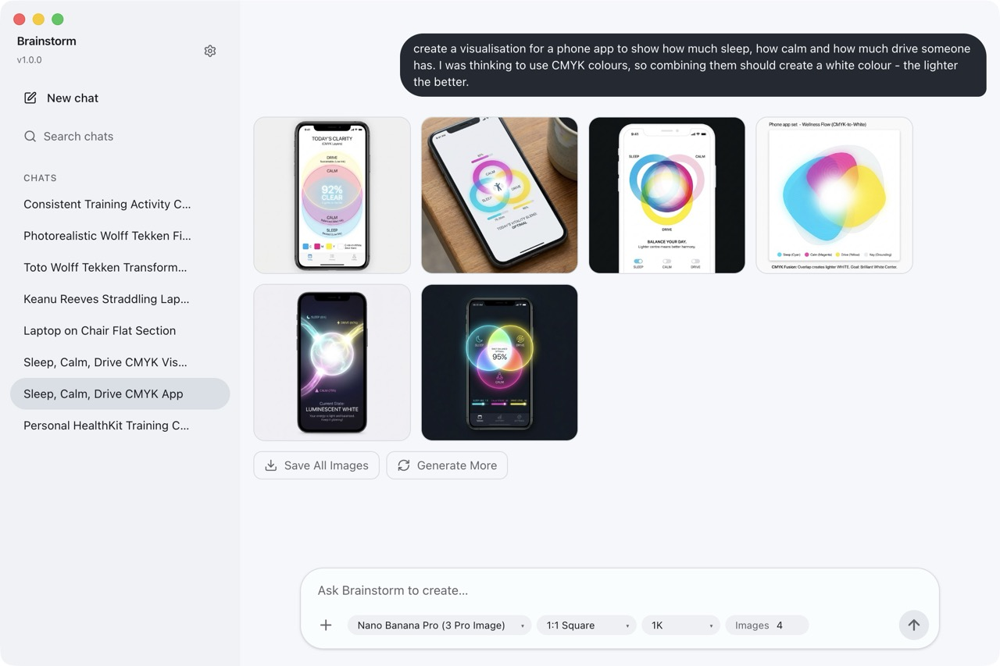

# Brainstorm

A desktop app for batch image generation powered by Google Gemini. Describe what you want, pick a model, and Brainstorm generates multiple variations in one go.



## Features

- **Batch generation** — generate multiple images from a single prompt
- **Multi-turn conversations** — refine results iteratively, with full chat history
- **Model and format controls** — choose the Gemini model, aspect ratio, resolution, and image count
- **Image context** — attach reference images to guide generation
- **Auto-titled chats** — conversations are named automatically for easy recall


## Setup

Requires a [Google Gemini API key](https://aistudio.google.com/apikeys).

```sh
yarn install
yarn start
```

## Building

```sh
yarn make
```

Signed macOS builds are produced via GitHub Actions on version tag pushes. See `.github/workflows/` for details.

## License

ISC
